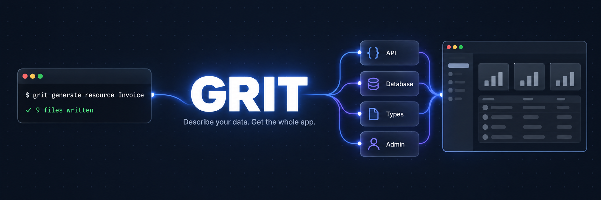
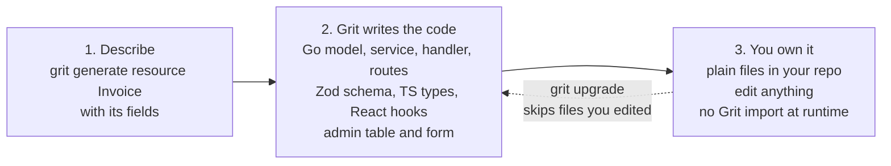
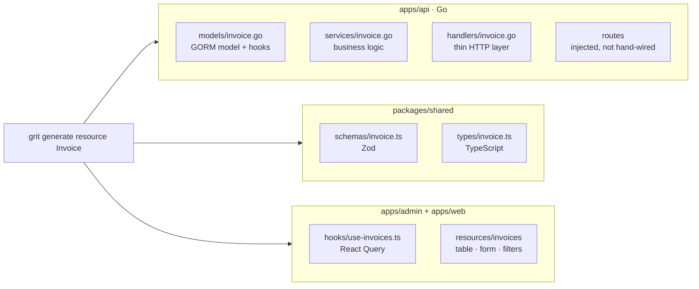
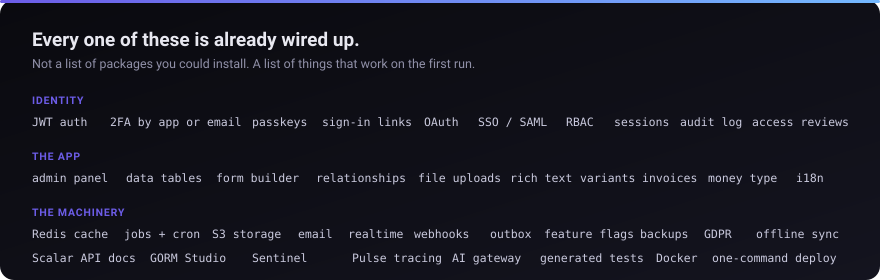

<p align="center">
  
</p>

<h1 align="center">Grit</h1>

<p align="center">
  <strong>Describe your data. Get the whole app.</strong><br />
  A full-stack framework for Go and React. One command writes the Go API, the database
  model, the TypeScript types, the React hooks and the admin screen. Auth, jobs, storage
  and deploy are already there. The code is plain Go and React, in your repository, and yours.
</p>

<p align="center">
  <a href="https://github.com/MUKE-coder/grit/releases"></a>
  <a href="https://github.com/MUKE-coder/grit/actions/workflows/ci.yml"></a>
  <a href="https://github.com/MUKE-coder/grit/actions/workflows/live.yml"></a>
  <a href="https://github.com/MUKE-coder/grit/actions/workflows/scan.yml"></a>
  <a href="https://github.com/MUKE-coder/grit/blob/main/LICENSE"></a>
  <a href="https://github.com/MUKE-coder/grit/stargazers"></a>
  <a href="https://gritframework.dev/sponsor"></a>
</p>

<p align="center">
  <a href="https://gritframework.dev/docs"><strong>Docs</strong></a> ·
  <a href="https://demo.gritframework.dev"><strong>Live demo</strong></a> ·
  <a href="#quick-start"><strong>Quick start</strong></a> ·
  <a href="#build-something-real-in-five-minutes"><strong>5-minute tutorial</strong></a> ·
  <a href="#for-teams-evaluating-grit"><strong>For teams</strong></a> ·
  <a href="https://gritframework.dev/roadmap"><strong>Roadmap</strong></a> ·
  <a href="https://chat.whatsapp.com/HXsOWlp5W6o9lV4YhsY376"><strong>Community</strong></a>
</p>

---

## What is Grit?

Most web apps need the same things before they do anything useful: sign-in, a database,
an API, a frontend that talks to it, an admin area to manage the data, emails, file
uploads, background jobs, and a way to deploy. Building and wiring those together takes
weeks.

**Grit is a command-line tool that writes all of that for you**, as ordinary Go and React
code in your own repository. You describe a thing your app works with, for example an
`Invoice` with a number, a total and a customer, and Grit writes every layer for it, from
the database table to the admin screen, already connected.

If you know **Laravel + Filament** or **Rails**, Grit is that idea for Go and React: a Go
backend that compiles to one binary, a React frontend, and a resource-based admin panel,
generated from one definition.

<table>
<tr>
<td width="50%" valign="top">

**New to full-stack development?**

You get a working app with login, an admin panel and a database in a few commands, then
learn by reading and changing real code. Start with the
[step-by-step route](https://gritframework.dev/docs/start), the
[glossary](https://gritframework.dev/docs/glossary), and the free
[course](https://gritframework.dev/courses).

</td>
<td width="50%" valign="top">

**Experienced developer or team lead?**

No runtime framework to depend on: the output is Gin, GORM and Next.js (or TanStack
Router) you can read and change. Upgrades never overwrite files you edited. Skip to
[how it works](#how-it-works), the [generated output](#one-command-nine-files-zero-wiring)
and [what to check before adopting it](#for-teams-evaluating-grit).

</td>
</tr>
</table>

---

## How it works



1. **Describe** a resource and its fields once. The field type (`money`, `email`,
   `belongs_to`, `file`, ...) decides the database column, the validation, the TypeScript
   type and the admin input.
2. **Grit writes** every layer and wires it in: routes registered, admin menu updated,
   types shared between the API and the frontends.
3. **You own** the result. There is no reflection and no hidden runtime: stop using the
   CLI tomorrow and the project still builds. Grit records what it wrote in
   `.grit/manifest.json`, so `grit upgrade` can deliver framework fixes later and still
   leave every file you changed alone.

---

## Quick start

### 1. What you need

| Tool | Version | Why |
|---|---|---|
| **Go** | 1.26+ | the API |
| **Node.js** | 20+ | the web and admin apps |
| **pnpm** | latest | installs the frontend packages |
| **Docker** | any recent | runs Postgres, Redis, MinIO (files) and Mailhog (email) locally |

The Grit CLI itself needs none of these. No Docker, or low on RAM? Grit also runs against
free cloud tiers (Neon, Upstash, Cloudflare R2, Resend):
[installing without Docker](https://gritframework.dev/docs/getting-started/installation).
[Full prerequisites](https://gritframework.dev/docs/getting-started/prerequisites).

### 2. Install the CLI

```bash
curl -fsSL https://gritframework.dev/install.sh | sh        # macOS, Linux, Git Bash
```

```powershell
irm https://gritframework.dev/install.ps1 | iex             # Windows PowerShell
```

Check it worked with `grit version`. If your shell says `grit: command not found`, see
[troubleshooting](https://gritframework.dev/docs/getting-started/troubleshooting).

<details>
<summary>Other ways to install</summary>

```bash
go install github.com/MUKE-coder/grit/v3/cmd/grit@latest    # with a Go toolchain
GRIT_VERSION=v3.320.0 curl -fsSL https://gritframework.dev/install.sh | sh   # pin a release
```

`grit update` updates the CLI. The generated `go.mod` pins the exact Go patch release, for
the vulnerability fixes in it; an older toolchain downloads that version, which needs a
network.

</details>

### 3. Create and run an app

```bash
grit new myapp --triple --next   # a website, an admin panel and an API
cd myapp
docker compose up -d             # Postgres, Redis, MinIO, Mailhog
pnpm install
grit migrate                     # create the database tables
grit seed                        # an admin user and demo data
grit start                       # run everything
```

> **First time?** `grit setup` does the same thing as an interactive installer: it asks a
> few questions, installs the dependencies and starts the app. And if you run plain
> `grit new myapp`, accepting the defaults gives you the setup above.

### 4. What you get

| Open | What it is |
|---|---|
| http://localhost:3000 | Your website, with register, login, password reset and two-factor |
| http://localhost:3001 | The admin panel. Sign in as `admin@example.com` / `admin123`. This is a development default: change it before you deploy, or set `SEED_ADMIN_PASSWORD` before `grit seed` |
| http://localhost:8080/docs | Interactive API reference, generated from the routes |
| http://localhost:8080/studio | A browser for your database tables |
| http://localhost:8025 | Mailhog: every email your app sends, caught locally |

Prefer to look before installing? **[demo.gritframework.dev](https://demo.gritframework.dev)**
is a real application built with Grit (inventory, point of sale, loans and mobile-money
collections), and its whole source is in [`demo/`](demo).

<p align="center">
  
</p>

> **Cloned a teammate's project?** `grit env` writes your `.env` from `.env.example` and
> generates every secret.

---

## One command, nine files, zero wiring

```bash
grit generate resource Invoice --fields "number:string:auto:INV,total:money,status:select:draft|sent|paid,customer:belongs_to:Customer,due:date"
```



Run `grit migrate` and the admin has a working invoices screen: stat cards, search, date
filters, sortable columns, bulk actions, CSV import and export. The customer picker is
searchable. The total is money, not a float. The invoice number fills itself in from a
gap-free counter (`INV-202609-0001`). The API validates against the same Zod schema as the
form.

It holds up under load, too: `grit seed Contact --count 1000000` fills a table with a
million realistic rows in about fifty seconds on Postgres, batched and resumable, and the
admin still pages through them instantly.

<details>
<summary><strong>Where things live in a generated project</strong></summary>

```text
myapp/
├── apps/
│   ├── api/                  Go API (Gin + GORM)
│   │   ├── cmd/              entry points: server, migrate, seed
│   │   └── internal/
│   │       ├── models/       your data: one file per resource
│   │       ├── services/     business logic, where most of your edits go
│   │       ├── handlers/     thin HTTP layer
│   │       ├── routes/       generated wiring
│   │       ├── policies/     who may touch which record
│   │       └── ...           jobs, mail, storage, cache, audit, realtime
│   ├── web/                  public website (Next.js or TanStack Router)
│   └── admin/                admin panel
├── packages/
│   └── shared/               Zod schemas and TypeScript types, used by every app
├── docker-compose.yml        Postgres, Redis, MinIO, Mailhog
└── .grit/                    what Grit generated, so upgrades know what is yours
```

Not sure about a file? `grit explain <file>` says what it is for and whether to edit it,
and `grit own <file>` says what `grit upgrade` will do to it.
[Project structure](https://gritframework.dev/docs/getting-started/project-structure).

</details>

---

## What ships in every project

<p align="center">
  
</p>

<table>
<tr>
<td width="50%"><br /><sub><b>Auth UI.</b> Sign in, register, reset, verify, 2FA.</sub></td>
<td width="50%"><br /><sub><b>Forms.</b> Built from your field definitions, pickers included.</sub></td>
</tr>
<tr>
<td width="50%"><br /><sub><b>Roles and permissions.</b> Per resource, from one command.</sub></td>
<td width="50%"><br /><sub><b>Line items and money.</b> Integer minor units, never floats.</sub></td>
</tr>
<tr>
<td width="50%"><br /><sub><b>Jobs, cron, mail.</b> With a dashboard, not just a queue.</sub></td>
<td width="50%"><br /><sub><b>API docs.</b> Generated from the routes, always current.</sub></td>
</tr>
<tr>
<td width="50%"><br /><sub><b>Every resource gets this.</b> Sort, filter, search, page, import, export.</sub></td>
<td width="50%"><br /><sub><b>One account screen.</b> Password, 2FA, passkeys, sign-in links, devices.</sub></td>
</tr>
</table>

One API, every client: [web](https://gritframework.dev/docs/frontend/web-app) ·
[admin](https://gritframework.dev/docs/admin/overview) ·
[mobile (Expo)](https://gritframework.dev/docs/mobile/getting-started) ·
[desktop (Wails)](https://gritframework.dev/docs/desktop/getting-started)

---

## Why developers pick Grit

|   | Assemble it yourself | With Grit |
|---|---|---|
| **Day one** | Choose a router, ORM, auth library, validator, mailer, queue, S3 client and admin kit, then wire them together | `grit new` |
| **A new entity** | Model, migration, service, handler, routes, DTOs, TS types, fetch hooks, table, form: nine files by hand | One `grit generate resource` |
| **Types across the stack** | Kept in sync by discipline | Go → Zod + TypeScript, via `grit sync` |
| **Admin panel** | Rebuilt for every project | Tables, forms, filters, bulk actions and widgets from the resource definition |
| **Test data** | A seed script you write and wait on | `grit seed Contact --count 1000000`: batched, resumable, realistic |
| **Payments, push, video** | A week of integration each | `grit plugin add stripe` · `push` · `video` |
| **Security** | A checklist for "later" | CSRF, strict CSP, request filtering and rate limiting, 2FA, passkeys, IDOR-safe ownership checks and a verifiable audit log, in the scaffold |
| **Deploy** | Dockerfiles, reverse proxy, TLS, systemd | `grit deploy --host user@server --domain myapp.com` |

---

## Build something real in five minutes

A support desk with customers, issues, a filterable table, a form with a customer picker,
a REST API and fifty rows of realistic data.

**1. Scaffold and start the infrastructure.**

```bash
grit new helpdesk --triple --next
cd helpdesk
docker compose up -d
pnpm install
```

**2. Model the domain.** One command per noun.

```bash
grit generate resource Customer --fields "name:string,email:email,company:string:optional"

grit generate resource Issue --fields "subject:string,body:richtext,priority:select:low=Low|normal=Normal|high=High,status:select:open=Open|closed=Closed,customer:belongs_to:Customer" --seed --faker --count 50
```

Each command writes nine files and the wiring: a GORM model, a service, a handler, the
routes, a Zod schema shared by every frontend, TypeScript types, React Query hooks, an
admin page and its resource definition.

(Why `Issue` and not `Ticket`? Grit already ships a support-desk `Ticket`, so the name is
one of about forty the generator reserves. It tells you which feature holds a reserved
name instead of writing over it.)

**3. Migrate, seed and run.**

```bash
grit migrate
grit seed
grit start
```

**4. Look at what you have.** At http://localhost:3001 there is an Issues screen with
sorting, filtering, search, pagination and bulk selection; a create form with a rich-text
editor, two dropdowns and a searchable customer picker; and full CRUD behind role guards.
http://localhost:8080/docs documents the endpoints behind it, and `/studio` shows the rows.

**5. Add a column later**, without regenerating. It goes into the model, both Zod schemas,
the TypeScript type, the admin form and the table:

```bash
grit generate field Issue resolved_at:datetime
grit migrate
```

Scalar, select and toggle columns work this way. For a relationship, file, slug or array
field, regenerate the resource.

**6. Ship it.**

```bash
grit deploy --host you@server.com --domain helpdesk.com
```

SSH, systemd and Caddy with automatic HTTPS.
[Deployment guides](https://gritframework.dev/docs/deployment) cover Railway, Render,
Fly.io, Coolify, Dokploy and a plain VPS.

> Longer walkthroughs: [a CRM](https://gritframework.dev/blog/build-a-crm-with-grit) ·
> [a storefront](https://gritframework.dev/blog/build-a-storefront-with-grit) ·
> [an invoice app](https://gritframework.dev/blog/build-an-invoice-app-with-grit) ·
> [a mobile app](https://gritframework.dev/blog/build-mobile-app-with-grit) ·
> [a desktop app](https://gritframework.dev/blog/build-desktop-app-with-grit)

---

## Choose an architecture

| Mode | Command | What you get | Good for |
|---|---|---|---|
| **Triple** | `grit new app --triple` | Web + Admin + API, Turborepo monorepo | most products; the default |
| **Double** | `grit new app --double` | Web + API, no separate admin | apps whose users are the admins |
| **Single** | `grit new app --single` | One Go binary, SPA embedded with `go:embed` | internal tools, one small server |
| **API** | `grit new app --api` | Go API only | a backend for an existing frontend |
| **Mobile** | `grit new app --mobile` | API + Expo React Native | iOS and Android apps |
| **Desktop** | `grit new-desktop app` | Wails + Go + React + SQLite | offline desktop software |

Frontend: `--next` (App Router, default) or `--vite` (TanStack Router, SPA).
Database: `--db postgres|mysql|sqlite|memory`.
`grit new .` scaffolds into the current directory.
[Architecture guide](https://gritframework.dev/docs/concepts/architecture-modes).

## Field types

The field definition is the source of truth for the column, the validation, the type and
the admin input.

| Type | Go | Notes |
|---|---|---|
| `string` `text` `richtext` | `string` | required by default; `richtext` gets a Tiptap editor |
| `int` `uint` `float` | `int` `uint` `float64` | `float` for weights and ratings, never money |
| `bool` / `toggle` | `bool` | |
| `date` `datetime` `time` | `*time.Time` | |
| `money` | minor units + currency | **use this for money** |
| `email` `url` `domain` `tel` `country` `color` `percent` `rating` | `string` / number | checked and normalised on write; `tel:UG` sets a default country |
| `slug` | `string` | auto-unique from another field |
| `select` `radio` `check` | `string` / JSON | `status:select:draft=Draft\|paid=Paid` |
| `file` `files` | `FileRef` | S3-backed; `file:image` limits what is accepted |
| `json` `string_array` | JSON column | |
| `belongs_to` `one_to_one` | `string` | a UUID foreign key plus an index |
| `many_to_many` | `[]string` | junction table and a picker |

**Modifiers:** `:unique` `:optional` `:encrypted` `:sensitive` `:slug:<source>` `:belongs_to:<Model>`
`:many_to_many:<Model>` `:select:a=A|b=B` `:file:image`

[Full reference](https://gritframework.dev/docs/concepts/field-types)

---

## Plugins: whole features, generated

`grit plugin add` writes a feature into your project as code you own. `grit plugin update`
brings in fixes later without overwriting a file you edited, and `grit plugin remove`
reverses every file and every injection.

```bash
grit plugin add stripe            # one-off payments and subscriptions, webhook-verified
grit plugin add multitenant       # organisations, per-org roles, automatic query scoping
grit plugin add push              # push notifications to iOS and Android via Expo
grit plugin add video             # uploads converted to web-ready MP4 with posters
grit plugin add webhooks          # outgoing webhooks, signed to the Standard Webhooks spec
grit plugin add impersonate       # sign in as a user, with an audit trail
grit plugin add command-palette   # ⌘K across the admin
grit plugin add saved-views       # per-user named table views
grit plugin add device-pairing    # sign in a browser by scanning a QR from a signed-in phone
```

<details>
<summary>The separate <code>grit-plugins</code> Go modules</summary>

The [`grit-plugins`](https://github.com/MUKE-coder/grit-plugins) Go packages are a
different thing: ordinary modules you import and wire yourself, *not* installed by
`grit plugin add`. They are early (v0.3.0): they build, vet and carry contract tests, but
several still store `user_id` as `uint` while a Grit `User.ID` is a UUID string. Check core
first, since `grit-websockets` duplicates the realtime module every app already ships.
[Plugin docs](https://gritframework.dev/docs/plugins/overview).

</details>

---

## Let an AI build it

Grit is a code generator, and agents that don't know that hand-write the nine files and
wonder why nothing is reachable. A skill teaches them:

```bash
npx skills add MUKE-coder/grit --skill grit
```

Then paste the build prompt, which sets out the whole job in nine steps and tells the
agent to ask what you are building before it scaffolds anything:

```bash
curl -s https://gritframework.dev/prompt
```

Or copy it from [gritframework.dev/docs/ai-integration](https://gritframework.dev/docs/ai-integration),
which has a wizard that narrows the brief to your stack. The skill is readable at
[gritframework.dev/skill.md](https://gritframework.dev/skill.md), there is an
[MCP server](https://gritframework.dev/docs/ai-workflows/mcp), and `grit init` writes
`CLAUDE.md` / `AGENTS.md` into a project.

---

## For teams evaluating Grit

The questions a tech lead asks first, answered plainly.

**What do we depend on at runtime?** Nothing from Grit. Your application imports Gin,
GORM, Next.js and the other libraries it uses, not Grit.
[Governance & risk](https://gritframework.dev/docs/governance) has a thirty-second check
that proves it.

**What happens when we edit generated code?** It is yours. `grit upgrade` updates only
framework-owned files you have not changed, tells you what it skipped and why, and
`grit upgrade --plan` writes the skipped changes into `UPGRADE-PLAN.md` for you to apply
by hand. `--dry-run` previews; `--to <version>` pins a release.
[Upgrades](https://gritframework.dev/docs/upgrades).

**How is security handled?** CSRF, strict CSP, rate limiting, 2FA, passkeys, SSO,
ownership checks and a hash-chained audit log are in the scaffold. `grit doctor` audits a
project for silent mistakes (an owned resource read without its owner scope, a
database browser left on its default password) and exits non-zero in
CI; `grit scout` scans a running deployment. [Security](https://gritframework.dev/docs/security).

**How stable is it?** Grit releases almost daily. Every release scaffolds fresh projects in
every shape, builds them, lints them and runs their tests, then re-checks against the
published binary. Breaking changes are labelled in the
[changelog](https://gritframework.dev/docs/changelog), and
[versioning](https://gritframework.dev/docs/versioning) explains the numbers.
[What is stable and what is not](https://gritframework.dev/docs/stability).

**Who maintains it?** One maintainer, which is the first thing to weigh and the first
thing [Governance & risk](https://gritframework.dev/docs/governance) says, along with what
limits the exposure and how the project is funded. The
[roadmap](https://gritframework.dev/roadmap) lists what is next, what is waiting on a
decision, and what was decided against. For what he is optimising for, and why the
framework is shaped this way, he answers that at length in
[Why I built Grit](https://gritframework.dev/blog/why-i-built-grit-the-long-answer).

**Can we adopt it in an existing codebase?** Yes, one piece at a time:
[using Grit with an existing project](https://gritframework.dev/docs/getting-started/existing-projects).

### When not to use Grit

Better to say this now than waste your weekend.

- **Your core is an unusual data model or request lifecycle.** Grit is at its best on
  CRUD-shaped products with an admin surface.
- **Your team is all TypeScript**, and one language everywhere matters more to you than a
  Go backend. AdonisJS or Nest will suit you better.
- **Data science or ML is the product.** Python's ecosystem wins there, and it is not close.
- **You would rather depend on a library than own generated code.** Grit's output is yours
  to maintain. Upgrades patch what they safely can; code you rewrote is your own.

The full reasoning, including what each decision costs, is in
[Why Grit](https://gritframework.dev/docs/getting-started/philosophy).

---

## FAQ

<details>
<summary><strong>Do I need to know Go?</strong></summary>

It helps, but you can start without it. The generated Go is small, conventional and
commented, and most of your edits go in `services/`. The docs include
[Go for Grit developers](https://gritframework.dev/docs/prerequisites/golang), and there
are primers for Docker and Next.js alongside it.

</details>

<details>
<summary><strong>Is it free?</strong></summary>

Yes. Grit is MIT licensed, and the code it generates is yours to use however you like. Paid
[blueprints](https://gritframework.dev/blueprints) (finished starter apps) are optional.

</details>

<details>
<summary><strong>What if I stop using Grit?</strong></summary>

Your project keeps building and running. It is a normal Go module and normal React apps;
the CLI only writes files.

</details>

<details>
<summary><strong>I'm coming from Laravel, Django, Rails or Next.js. Where do I start?</strong></summary>

[Coming from another framework](https://gritframework.dev/docs/getting-started/coming-from)
maps the concepts you know to Grit's.

</details>

<details>
<summary><strong>Something went wrong during setup.</strong></summary>

[Troubleshooting](https://gritframework.dev/docs/getting-started/troubleshooting) covers
the common first-run errors (PATH, Docker, ports). Still stuck? Ask in the
[WhatsApp community](https://chat.whatsapp.com/HXsOWlp5W6o9lV4YhsY376). No question is too
small.

</details>

<details>
<summary><strong>CLI reference and tech stack</strong></summary>

```bash
# Scaffolding
grit new <name>                        # interactive
grit new <name> --triple --next        # explicit
grit setup                             # interactive installer
grit new-desktop <name>                # desktop app (Wails)

# Generating
grit generate resource <Name> --fields "..."   # also: grit g
grit generate resource <Name> --seed --faker --count 500
grit generate field <Resource> <name:type>     # one column, in place
grit generate seeder <Resource>
grit generate migration <name>                 # a SQL pair for what AutoMigrate cannot do
grit generate migration <name> --index t:col   # CREATE INDEX CONCURRENTLY, done right
grit generate form <Resource>                  # multi-step form
grit generate table <Resource>
grit remove resource <Name>                    # reverses every injection
grit add role <ROLE>
grit add variants --resource <Resource>
grit sync                              # Go types -> TypeScript + Zod

# Running
grit start                             # everything
grit start server | grit start client
grit studio                            # GORM Studio
grit routes                            # what is actually mounted
grit doctor                            # audit for silent security mistakes

# Understanding a project
grit explain <file>                    # what a file is for, whether to edit it
grit own <file>                        # what grit upgrade will do to it

# Database
grit migrate                           # run migrations
grit migrate --fresh | status | down
grit migrate down --sql                # undo the most recent SQL migration
grit seed
grit backup | grit restore

# Plugins
grit plugin list | add <name> | remove <name> | update

# Operations
grit down                              # maintenance mode
grit up
grit deploy --host user@server --domain example.com

# Meta
grit version | grit update             # the CLI
grit upgrade                           # this project's framework files
```

[Full CLI docs](https://gritframework.dev/docs/cli)

| Layer | Technology |
|---|---|
| Backend | Go 1.26+ · Gin · GORM |
| Frontend | Next.js 16 (App Router, pinned exactly) **or** TanStack Router (Vite) |
| Styling | Tailwind CSS · shadcn/ui |
| Database | PostgreSQL · MySQL 8+ / MariaDB · SQLite |
| Cache / queue | Redis · asynq |
| Storage | S3-compatible (MinIO, Cloudflare R2, AWS S3) |
| Email | Resend |
| AI | Vercel AI Gateway |
| Auth | JWT · TOTP · passkeys · OAuth2 · SSO (OIDC, SAML) |
| Validation | Zod, shared between apps |
| Data fetching | TanStack Query |
| Monorepo | Turborepo · pnpm |
| Security | Sentinel (request filtering, rate limiting) |
| Observability | Pulse (tracing, metrics) |
| DB browser | GORM Studio |
| Desktop / mobile | Wails v2 · Expo |
| Deploy | SSH + systemd + Caddy (auto-TLS) |

</details>

---

## Learn more

- **[gritframework.dev/docs/start](https://gritframework.dev/docs/start)**: one ordered route from nothing to deployed
- **[Documentation](https://gritframework.dev/docs)**: guides, tutorials and the API reference
- **[Free course](https://gritframework.dev/courses)**: ten parts, from first project to production
- **[Glossary](https://gritframework.dev/docs/glossary)**: every Grit term in plain English
- **[Changelog](https://gritframework.dev/docs/changelog)** ([CHANGELOG.md](CHANGELOG.md)): every release, explained

## Community

- **[WhatsApp community](https://chat.whatsapp.com/HXsOWlp5W6o9lV4YhsY376)**: questions,
  help, and the person who builds Grit.
- **[Discussions](https://github.com/MUKE-coder/grit/discussions)**: ideas, and anything
  that needs more than a chat message.
- **[Issues](https://github.com/MUKE-coder/grit/issues)**: bugs. The template asks for the
  version, the steps and the output, which is what gets a bug fixed this week.
- **Star the repo** if Grit saved you a week. It is how other developers find it.

Building with Grit? Add the badge:

```markdown
[](https://gritframework.dev)
```

## Sponsors

Grit is free and MIT licensed. Sponsorship pays for the features, docs and releases
everyone else gets for free, and puts your name in front of every developer who builds
with Grit.

<!-- sponsors:start -->
<p align="center">
  <em>Grit has no sponsors yet. Be the first. Your logo goes here, on the home page, and inside the CLI.</em>
</p>
<!-- sponsors:end -->

<p align="center">
  <a href="https://gritframework.dev/sponsor"><strong>Become a sponsor →</strong></a>
</p>

## Contributing

Bug reports, fixes and documentation corrections are welcome and merged quickly. Anything
larger is worth an issue first, because a change here lands in every project built
afterwards. [CONTRIBUTING.md](CONTRIBUTING.md) has the setup and the layout of the
repository; [AGENTS.md](AGENTS.md) explains why most of `internal/` is code that writes
code. Questions and ideas belong in
[Discussions](https://github.com/MUKE-coder/grit/discussions).

Taking part means agreeing to the [Code of Conduct](CODE_OF_CONDUCT.md).

## Security

If you find a security problem, please don't open an issue.
[SECURITY.md](SECURITY.md) says how to report it privately, what is in scope, and how
releases are signed and verified.

## License

[MIT](LICENSE)
